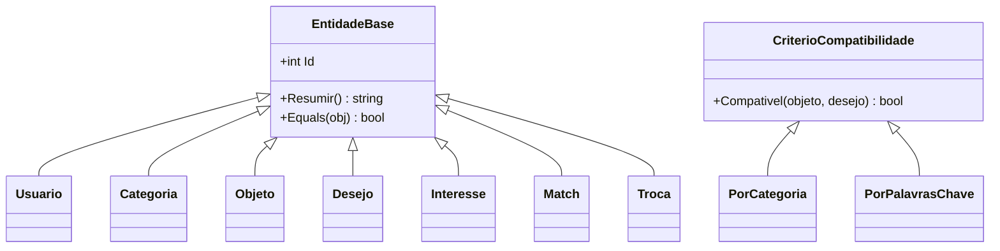
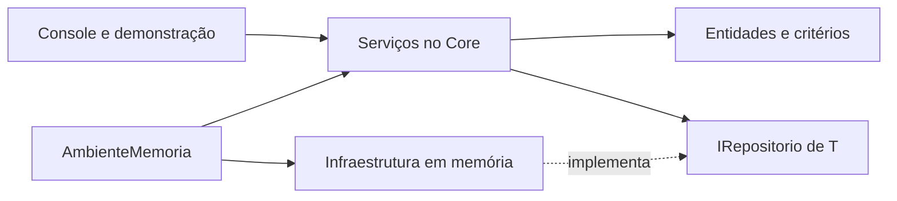

# Escolhas arquiteturais do Fechô

## Ponto de partida e refatoração

Não existia uma implementação anterior. A base foi criada a partir do SQL e dos
slides, já extraindo os comportamentos comuns. O histórico registra esse
desenvolvimento; não representa a refatoração de um sistema legado existente.

O problema de duplicação que a abstração evita pode ser explicado com este
**trecho didático**, que não é uma versão antiga do repositório:

```csharp
// Sem a abstração, identidade e igualdade seriam repetidas em cada classe.
class Usuario { public int Id { get; } /* Equals e GetHashCode repetidos */ }
class Objeto  { public int Id { get; } /* Equals e GetHashCode repetidos */ }
class Desejo  { public int Id { get; } /* Equals e GetHashCode repetidos */ }
```

Na implementação real, `EntidadeBase` fornece `Id`, a validação do identificador,
`Equals`, `GetHashCode` e `ToString`. Cada entidade implementa `Resumir()`.
O ID é imutável e a igualdade considera **tipo concreto + ID**. Assim, um usuário
e um objeto com o mesmo número não são iguais, enquanto duas representações
da mesma categoria têm a mesma identidade.

Essa definição é usada de fato pelo `HashSet<Objeto>` da descoberta. Alterar
atributos que participam da igualdade enquanto um elemento está em um conjunto
pode comprometer sua localização; por isso nome, status e descrição não entram
no cálculo de identidade.



Não foram criadas subclasses `Cliente` e `Administrador`: o projeto apresentado
não define esses perfis, e o banco não possui campo de papel. O exemplo do
enunciado orienta a técnica; a hierarquia aplicada respeita o negócio do Fechô.

## Herança também nos repositórios

`RepositorioMemoria<T>` concentra armazenamento por ID, geração de identificadores,
busca e listagem. Seu método `Adicionar()` chama o método protegido e virtual
`ValidarNovo()` antes da inclusão. As subclasses implementam somente suas restrições:

| Subclasse | Regra acrescentada |
| --- | --- |
| `RepositorioUsuarios` | E-mail único, sem diferenciar maiúsculas |
| `RepositorioCategorias` | Nome único, normalizando maiúsculas e acentos |
| `RepositorioInteresses` | Um registro por usuário e objeto |
| `RepositorioTrocas` | Uma troca por match |

`Objeto`, `Desejo` e `Match` usam diretamente o repositório genérico porque a
criação pelos serviços já verifica suas regras. Não há subclasses vazias para
cada tabela. A normalização em memória é uma aproximação; não reproduz todas
as regras de collation do MySQL.

Os serviços conhecem a interface `IRepositorio<T>`, não uma coleção global nem
a classe concreta de armazenamento. O despacho de `ValidarNovo()` continua
funcionando quando o repositório é referenciado pela interface.

## Polimorfismo nas regras de descoberta

`DescobertaService.Descobrir()` recebe um `CriterioCompatibilidade`:

```csharp
CriterioCompatibilidade criterio = new PorCategoria();
var amplos = app.Descoberta.Descobrir(usuarioId, criterio);

criterio = new PorPalavrasChave();
var especificos = app.Descoberta.Descobrir(usuarioId, criterio);
```

O serviço chama `Compativel()` sem testar o tipo concreto com `if` ou `switch`.
`PorCategoria` aceita objetos da categoria desejada. `PorPalavrasChave` verifica
todas as palavras da descrição do desejo no nome/descrição do objeto, ignorando
acentos e maiúsculas e respeitando a categoria quando ela é informada.

O comportamento compartilhado de categoria está na superclasse. Um terceiro
critério pode ser acrescentado como outra subclasse e escolhido pelo chamador.
Não exige modificar o algoritmo que filtra proprietários, interesses e status.

São critérios simples de recomendação. A comparação textual usa substrings,
sem sinônimos, análise semântica ou IA. A política por categoria requer um desejo
com categoria; a textual também funciona com a categoria nula prevista no SQL.
**Recomendação não gera match:** dois likes explícitos continuam obrigatórios.

## List, Set e Dictionary

| Coleção | Aplicação | Justificativa |
| --- | --- | --- |
| `List<Objeto>` | Cards ordenados por cadastro, com ID como desempate | A sequência é observável e há acesso por índice, como `cards[0]` |
| `HashSet<Objeto>` | Cards compatíveis com vários desejos | O mesmo objeto aparece uma vez; usa a identidade de `EntidadeBase` |
| `HashSet<int>` | IDs de objetos já avaliados | Evita sugerir novamente um objeto com like ou dislike |
| `HashSet<(int,int)>` | Pares de objetos de matches ativos | O par é normalizado; `(3,8)` e `(8,3)` representam a mesma combinação |
| `List<Match>` | Histórico e novos matches | Preserva a sequência de apresentação; histórico mostra os mais recentes |
| `Dictionary<int,T>` | Armazenamento dos repositórios | Associa cada ID à sua entidade, evitando buscar por posição em uma lista |

Uma `List` permite duplicatas. Ela não garante sozinha a ausência de cards
repetidos: a descoberta combina a lista com o conjunto. Um `HashSet` garante
unicidade por igualdade, mas não representa a ordenação de negócio nem oferece
acesso posicional. Não se depende da ordem de iteração do conjunto.

As listagens devolvem snapshots com estrutura somente de leitura. As entidades
continuam compartilhadas para que os serviços possam refletir as transições de
estado. Portanto, não se trata de uma cópia profunda imutável de todo o domínio.

## Separação de responsabilidades



- `CadastroService`: usuários, conferência de credenciais, categorias, objetos e desejos.
- `DescobertaService`: preparação e ordenação dos cards usando um critério variável.
- `TrocaService`: registro/atualização de interesses, reciprocidade, histórico,
  autorização de contato, cancelamento e conclusão.
- `AmbienteMemoria`: instancia os repositórios e injeta as dependências nos serviços.

Não foi usado um framework de injeção de dependências. A composição explícita
mantém visível quais objetos cada serviço recebe, o que ajuda nesta entrega.

## Decisões de negócio adotadas

O material não detalhava todos os casos abaixo; estas são as decisões da implementação:

- Para registrar interesse, exige-se ao menos um objeto **disponível**, além de
  usuário ativo. Ter somente objetos já trocados não habilita novas trocas.
- Um usuário pode ter vários objetos e vários matches. O cruzamento considera
  os objetos efetivamente curtidos, não qualquer objeto dos mesmos proprietários.
- Repetir uma avaliação atualiza o mesmo registro. Trocar like por dislike
  cancela matches ativos dependentes daquele interesse.
- O cancelamento preserva o histórico. Um novo like pode criar outro match se
  a reciprocidade continuar válida, sem reativar o registro cancelado.
- Um match ativo não reserva automaticamente os objetos. Eles podem participar
  de outras propostas; ao concluir uma troca, as propostas concorrentes são canceladas.
  `EM_NEGOCIACAO` permanece no enum por compatibilidade com o banco, sem transição
  usada nesta etapa. O mesmo vale para `INATIVO` nos objetos.
- Qualquer participante pode registrar a conclusão. A dupla confirmação não foi
  implementada porque o SQL não guarda confirmações individuais.
- O contato continua disponível no histórico concluído, mas é revogado em matches
  cancelados. Usuários inativos não negociam nem têm seu contato liberado.

## Limites e próxima integração

A aplicação é monoprocesso e sequencial, com dados voláteis. Não há garantia de
concorrência, transações ou durabilidade. A conclusão valida os dados antes de
alterar estados; isso não substitui uma transação de banco.

Um adaptador MySQL precisará implementar gravação e reidratação das entidades,
atualização dos estados e interesses, IDs gerados pelo banco, chaves estrangeiras,
tratamento de violações de unicidade e uma transação para concluir/cancelar matches.
O contrato de repositório atual cobre as operações desta etapa em memória e
deverá evoluir para atualizações e unidade de trabalho. Somente trocar a classe
do repositório ainda não implementa essa persistência.

O método de autenticação confere hashes PBKDF2 com salt individual. Não implementa
sessões, tokens, recuperação de senha ou bloqueio por tentativas. Em uma futura
API, `solicitanteId` deve vir da sessão autenticada, nunca ser aceito como prova
de identidade apenas porque foi enviado pelo cliente. Os serviços desta entrega
são uma biblioteca local, sem fronteira de segurança HTTP.

## Respostas curtas para o debate

**Por que List e não Set no histórico?** Porque o mais recente deve aparecer
primeiro e a posição tem significado para a interface. O Set é usado onde a
unicidade é a regra, como a eliminação de cards repetidos.

**A herança trouxe benefício prático?** Sim: identidade e igualdade aparecem
uma vez para sete entidades; operações de repositório são compartilhadas;
critérios de descoberta variam mantendo o mesmo chamador. A hierarquia é curta.

**Por que não colocar as regras no console?** Porque uma futura interface web
também precisará delas. O console mostra o comportamento; os serviços o decidem.

**Por que não adicionar Administrador?** Porque seria uma regra nova sem base
nos requisitos e no SQL. Não se criou um perfil somente para satisfazer um exemplo.

## Referências

- [List<T> — Microsoft](https://learn.microsoft.com/en-us/dotnet/api/system.collections.generic.list-1)
- [HashSet<T> — Microsoft](https://learn.microsoft.com/en-us/dotnet/api/system.collections.generic.hashset-1)
- [Herança em C# — Microsoft](https://learn.microsoft.com/en-us/dotnet/csharp/fundamentals/object-oriented/inheritance)
- [Polimorfismo em C# — Microsoft](https://learn.microsoft.com/en-us/dotnet/csharp/fundamentals/object-oriented/polymorphism)
