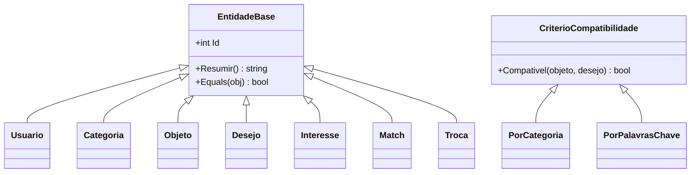
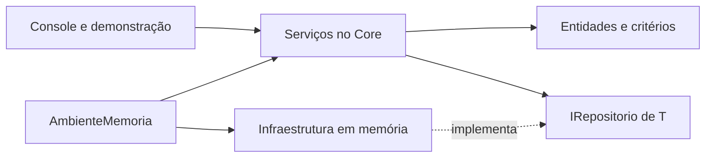
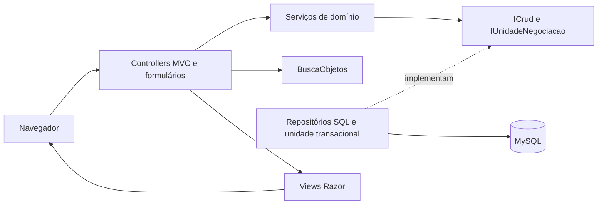

# Escolhas arquiteturais do Fechô

## Ponto de partida e refatoração

Não existia uma implementação anterior. A base foi criada a partir do SQL e dos
slides, já extraindo os comportamentos comuns. O histórico registra esse
desenvolvimento; não representa a refatoração de um sistema legado existente.

O problema de duplicação que a abstração evita pode ser explicado com este
**trecho didático**, que não é uma versão antiga do repositório:

```csharp
// Sem a abstração, identidade e igualdade seriam repetidas em cada classe.
class Usuario { public int Id { get; } /* Equals e GetHashCode repetidos */ }
class Objeto  { public int Id { get; } /* Equals e GetHashCode repetidos */ }
class Desejo  { public int Id { get; } /* Equals e GetHashCode repetidos */ }
```

Na implementação real, `EntidadeBase` fornece `Id`, a validação do identificador,
`Equals`, `GetHashCode` e `ToString`. Cada entidade implementa `Resumir()`.
O ID é imutável e a igualdade considera **tipo concreto + ID**. Assim, um usuário
e um objeto com o mesmo número não são iguais, enquanto duas representações
da mesma categoria têm a mesma identidade.

Essa definição é usada de fato pelo `HashSet<Objeto>` da descoberta. Alterar
atributos que participam da igualdade enquanto um elemento está em um conjunto
pode comprometer sua localização; por isso nome, status e descrição não entram
no cálculo de identidade.



Não foram criadas subclasses `Cliente` e `Administrador`: o projeto apresentado
não define esses perfis, e o banco não possui campo de papel. O exemplo do
enunciado orienta a técnica; a hierarquia aplicada respeita o negócio do Fechô.

## Herança também nos repositórios

`RepositorioMemoria<T>` concentra armazenamento por ID, geração de identificadores,
busca e listagem. Seu método `Adicionar()` chama o método protegido e virtual
`ValidarNovo()` antes da inclusão. As subclasses implementam somente suas restrições:

| Subclasse | Regra acrescentada |
| --- | --- |
| `RepositorioUsuarios` | E-mail único, sem diferenciar maiúsculas |
| `RepositorioCategorias` | Nome único, normalizando maiúsculas e acentos |
| `RepositorioInteresses` | Um registro por usuário e objeto |
| `RepositorioTrocas` | Uma troca por match |

`Objeto`, `Desejo` e `Match` usam diretamente o repositório genérico porque a
criação pelos serviços já verifica suas regras. Não há subclasses vazias para
cada tabela. A normalização em memória é uma aproximação; não reproduz todas
as regras de collation do MySQL.

Os serviços conhecem a interface `IRepositorio<T>`, não uma coleção global nem
a classe concreta de armazenamento. O despacho de `ValidarNovo()` continua
funcionando quando o repositório é referenciado pela interface.

## Polimorfismo nas regras de descoberta

`DescobertaService.Descobrir()` recebe um `CriterioCompatibilidade`:

```csharp
CriterioCompatibilidade criterio = new PorCategoria();
var amplos = app.Descoberta.Descobrir(usuarioId, criterio);

criterio = new PorPalavrasChave();
var especificos = app.Descoberta.Descobrir(usuarioId, criterio);
```

O serviço chama `Compativel()` sem testar o tipo concreto com `if` ou `switch`.
`PorCategoria` aceita objetos da categoria desejada. `PorPalavrasChave` verifica
todas as palavras da descrição do desejo no nome/descrição do objeto, ignorando
acentos e maiúsculas e respeitando a categoria quando ela é informada.

O comportamento compartilhado de categoria está na superclasse. Um terceiro
critério pode ser acrescentado como outra subclasse e escolhido pelo chamador.
Não exige modificar o algoritmo que filtra proprietários, interesses e status.

São critérios simples de recomendação. A comparação textual usa substrings,
sem sinônimos, análise semântica ou IA. A política por categoria requer um desejo
com categoria; a textual também funciona com a categoria nula prevista no SQL.
**Recomendação não gera match:** dois likes explícitos continuam obrigatórios.

## List, Set e Dictionary

| Coleção | Aplicação | Justificativa |
| --- | --- | --- |
| `List<Objeto>` | Cards ordenados por cadastro, com ID como desempate | A sequência é observável e há acesso por índice, como `cards[0]` |
| `HashSet<Objeto>` | Cards compatíveis com vários desejos | O mesmo objeto aparece uma vez; usa a identidade de `EntidadeBase` |
| `HashSet<int>` | IDs de objetos já avaliados | Evita sugerir novamente um objeto com like ou dislike |
| `HashSet<(int,int)>` | Pares de objetos de matches ativos | O par é normalizado; `(3,8)` e `(8,3)` representam a mesma combinação |
| `List<Match>` | Histórico e novos matches | Preserva a sequência de apresentação; histórico mostra os mais recentes |
| `Dictionary<int,T>` | Armazenamento dos repositórios | Associa cada ID à sua entidade, evitando buscar por posição em uma lista |

Uma `List` permite duplicatas. Ela não garante sozinha a ausência de cards
repetidos: a descoberta combina a lista com o conjunto. Um `HashSet` garante
unicidade por igualdade, mas não representa a ordenação de negócio nem oferece
acesso posicional. Não se depende da ordem de iteração do conjunto.

As listagens devolvem snapshots com estrutura somente de leitura. As entidades
continuam compartilhadas para que os serviços possam refletir as transições de
estado. Portanto, não se trata de uma cópia profunda imutável de todo o domínio.

## Separação de responsabilidades



- `CadastroService`: usuários, conferência de credenciais, categorias, objetos e desejos.
- `DescobertaService`: preparação e ordenação dos cards usando um critério variável.
- `TrocaService`: registro/atualização de interesses, reciprocidade, histórico,
  autorização de contato, cancelamento e conclusão.
- `AmbienteMemoria`: instancia os repositórios e injeta as dependências nos serviços.

Não foi usado um framework de injeção de dependências. A composição explícita
mantém visível quais objetos cada serviço recebe, o que ajuda nesta entrega.

## Decisões de negócio adotadas

O material não detalhava todos os casos abaixo; estas são as decisões da implementação:

- Para registrar interesse, exige-se ao menos um objeto **disponível**, além de
  usuário ativo. Ter somente objetos já trocados não habilita novas trocas.
- Um usuário pode ter vários objetos e vários matches. O cruzamento considera
  os objetos efetivamente curtidos, não qualquer objeto dos mesmos proprietários.
- Repetir uma avaliação atualiza o mesmo registro. Trocar like por dislike
  cancela matches ativos dependentes daquele interesse.
- O cancelamento preserva o histórico. Um novo like pode criar outro match se
  a reciprocidade continuar válida, sem reativar o registro cancelado.
- Um match ativo não reserva automaticamente os objetos. Eles podem participar
  de outras propostas; ao concluir uma troca, as propostas concorrentes são canceladas.
  `EM_NEGOCIACAO` permanece no enum por compatibilidade com o banco, sem transição
  usada nesta etapa. O mesmo vale para `INATIVO` nos objetos.
- Qualquer participante pode registrar a conclusão. A dupla confirmação não foi
  implementada porque o SQL não guarda confirmações individuais.
- O contato continua disponível no histórico concluído, mas é revogado em matches
  cancelados. Usuários inativos não negociam nem têm seu contato liberado.

## MVP Web e persistência atual

A interface atual usa ASP.NET Core MVC com views Razor, aproveitando o Core C#.
As classes anteriores e a demonstração de POO em memória foram mantidas.
O console também oferece o CRUD local de categorias, usuários e objetos.



| Parte | Responsabilidade |
| --- | --- |
| `Fecho.Core` | Entidades, validações, contratos, algoritmo de busca e regras de negociação |
| `Fecho.Infraestrutura` | SQL parametrizado, mapeamento de linhas, conexões e transações |
| `Fecho.Web` | Rotas, autenticação HTTP, formulários, autorização por sessão e apresentação |
| `Fecho.Console` | Cadastros administrativos locais e cenário anterior em memória |

`ICrudUsuarios`, `ICrudCategorias` e `ICrudObjetos` explicitam inserção,
consulta, atualização e exclusão. O banco gera os IDs com AUTO_INCREMENT;
não se usa `MAX(id)+1`. `RepositorioMySql` compartilha abertura, descarte e
tradução de falhas. Cada escrita simples do CRUD é uma instrução SQL atômica.

Os SELECTs reconstituem entidades e seus vínculos. A leitura de objetos usa JOIN
para proprietário e categoria. Datas e estados gravados são mantidos; a edição
não redefine cadastro, dono ou status de negociação. Nome e descrição usam
parâmetros, inclusive quando contêm aspas ou textos semelhantes a SQL.

## Algoritmos e estruturas na interface

`CatalogoController` consulta o MySQL e chama `BuscaObjetos`. O algoritmo:

- normaliza os textos com `TextoNormalizado`, removendo diferenças de acento e caixa;
- percorre os objetos aplicando filtros e regras de disponibilidade;
- usa `HashSet<int>` para deduplicar IDs e ignorar avaliações descartadas;
- mantém uma `List<Objeto>` com os resultados e um `Dictionary<int,int>` com contagens por categoria;
- executa merge sort estável com array auxiliar e desempate determinístico por ID;
- aplica paginação somente depois de ordenar.

O filtro personalizado reutiliza o critério polimórfico `PorPalavrasChave` e
os desejos persistidos do usuário. A ordenação faz O(n log n) comparações e usa
O(n) de memória auxiliar. A busca textual também depende do número de palavras
e do tamanho dos campos. Estimativas ausentes ficam ao final nas duas direções;
`decimal` preserva centavos.

A escolha de filtrar uma coleção em memória torna o algoritmo observável no MVP
acadêmico. Um catálogo grande precisaria de filtragem, índices e paginação no banco.
Os cards exibem dados reais; as ilustrações de exemplo são SVGs locais versionados.

## Transações na negociação

`NegociacaoPersistenteService` fica no Core e usa `IUnidadeNegociacao` e
`IContextoNegociacao`, sem importar MySqlConnector. `UnidadeNegociacaoMySql`
implementa essas portas com uma conexão e uma transação por operação.
`RegrasNegociacao.ValidarAvaliacao` é compartilhada com o `TrocaService` anterior.

Ao registrar interesse, a unidade valida usuário/objeto, grava o interesse com
UPSERT e procura os likes recíprocos dos objetos específicos. Um `HashSet` de
pares normalizados evita repetir matches ativos. Dislike cancela os matches
ativos dependentes daquele interesse. Um match cancelado fica no histórico.

Ao concluir uma troca, a mesma transação:

1. Confere participante, usuários ativos, status do match e dos objetos e observação.
2. Insere a troca com data UTC.
3. Marca exatamente os dois objetos como TROCADO.
4. Marca o match como CONCLUIDO.
5. Cancela os demais matches ativos que compartilhem qualquer um dos objetos.
6. Confirma tudo com COMMIT; exceções impedem confirmação parcial.

Para evitar duplicação em requisições simultâneas, as escritas de negociação
bloqueiam as linhas de usuários em ordem com `SELECT ... FOR UPDATE`. Essa
serialização é simples e verificável para a demonstração local. Tem custo de
concorrência e não pretende atender um catálogo de grande escala. Leituras
usam transação consistente, sem essa trava de escrita.

## Sessão, propriedade e contato

O SQL não define Cliente/Administrador. A Web valida identidade autenticada,
propriedade e participação. O ID do dono de um novo objeto vem da cookie de
sessão, nunca de um campo enviado como prova de identidade.

- Senhas permanecem como PBKDF2-SHA256, 600 mil iterações, salt de 16 bytes e hash de 32 bytes.
- `SenhaProtegida.DaPersistencia` restaura o hash; não recalcula a senha na leitura.
- Perfil e alteração de senha são operações distintas. A edição cadastral mantém o hash existente.
- A cookie HttpOnly é protegida pelo ASP.NET Core Data Protection e tem duração máxima de quatro horas.
- Cada requisição autenticada reconfere conta ativa e uma impressão digital da credencial. Alterar a senha invalida sessões antigas.
- Todo POST MVC exige token CSRF. Logout é POST; GETs de páginas não alteram dados de negócio.
- URLs de retorno de login são limitadas ao próprio site.
- Login, criação de conta e troca de senha têm limite de tentativas por IP.
- Perfil só é consultado pelo titular. Telefone de outro usuário só é retornado após conferir participação em match não cancelado e usuários ativos.
- A Web não oferece endpoints para listar hashes ou administrar contas alheias.

As chaves de proteção e imagens ficam em `.tools/web` por padrão, fora do Git.
É possível configurar outro diretório local com `FECHO_DATA_DIR`. Apagar chaves
invalida sessões; apagar imagens remove os arquivos apontados pelos registros.
O `.env` é lido sem executar shell e variáveis exportadas têm prioridade.

## Validação de entrada e arquivos

Formulários têm limites e validações no servidor. As entidades repetem as regras
de domínio e as restrições do banco preservam unicidade e integridade referencial.
Views Razor escapam dados do usuário. Erros de banco exibem uma página segura.

O upload aceita PNG/JPEG/WebP com assinatura compatível, até 2 MB. O arquivo ganha
nome aleatório e extensão definida pelo servidor. O caminho original fornecido
pelo navegador não é usado para gravar arquivos. A Web serve somente a pasta de
imagens; chaves e configurações ficam fora dela. Exclusão de objeto com match é
impedida pelo banco, mantendo o histórico.

## Validação executada

Há verificadores por console para domínio/algoritmos, CRUD real e fluxo HTTP do
MVP. A suíte Web mantém três sessões e comprova permissões, contato, CSRF,
reciprocidade, matches repetidos e confirmações simultâneas. Os testes criam e
limpam fixtures próprias em um banco separado. O workflow executa essas suítes.
Detalhes e comandos em [MVP-WEB.md](MVP-WEB.md).

## Limites desta versão

O servidor é voltado à execução local da entrega. Não há OAuth, chat interno,
pagamentos, avaliações ou confirmação dupla de entrega. O esquema mantém uma
imagem por objeto. A publicação do repositório não hospeda automaticamente o
servidor C# ou o MySQL. A demonstração antiga em memória continua monoprocesso e
volátil; os novos fluxos Web usam o armazenamento persistente.

Os PDFs dos wireframes não estavam acessíveis nos caminhos originais. Os fluxos
foram implementados a partir dos documentos do repositório; a comparação visual
com os PDFs permanece pendente.

## Referências

- [MVC e validação de modelos — Microsoft](https://learn.microsoft.com/en-us/aspnet/core/mvc/models/validation?view=aspnetcore-10.0)
- [Proteção CSRF — Microsoft](https://learn.microsoft.com/en-us/aspnet/core/security/anti-request-forgery?view=aspnetcore-10.0)
- [Cookies de autenticação — Microsoft](https://learn.microsoft.com/en-us/aspnet/core/security/authentication/cookie?view=aspnetcore-10.0)
- [List — Microsoft](https://learn.microsoft.com/en-us/dotnet/api/system.collections.generic.list-1)
- [HashSet — Microsoft](https://learn.microsoft.com/en-us/dotnet/api/system.collections.generic.hashset-1)
