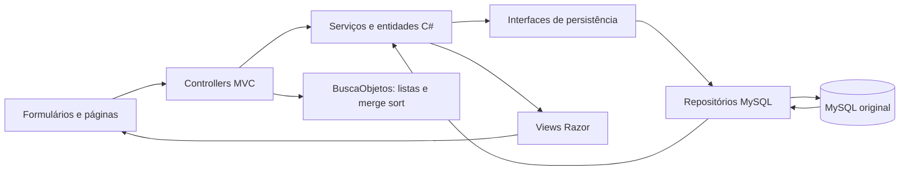

# MVP Web — execução e demonstração

Entrega: repositório GitHub atualizado e demonstração funcional de até 15 minutos.
A interface foi construída com ASP.NET Core MVC e Razor, aproveitando as entidades,
os serviços e os repositórios C# das etapas anteriores.

## Preparar o ambiente

### Com Docker

Instale SDK .NET 10, Docker Compose e OpenSSL. Na raiz:

```sh
bash scripts/preparar-local.sh --demo
bash scripts/fecho.sh web
```

Abra **http://localhost:5070**. O `.env` é criado com senhas aleatórias se não existir.
O script preserva configurações existentes e não remove volumes. `--demo` acrescenta
contas e objetos fictícios, sem apagar registros ou redefinir senhas existentes.
Sem esse argumento, prepara somente o MySQL. O volume é inicializado com o SQL
original da Entrega 4 apenas quando estiver vazio.

Contas fictícias: `ana.demo@fecho.local`, `bruno.demo@fecho.local` e
`clara.demo@fecho.local`. A senha escolhida para a primeira criação está em
`FECHO_DEMO_PASSWORD` no `.env`. Os nomes e contatos dessas contas são fictícios.
Não use uma senha pessoal na configuração da demonstração.

Para parar o servidor, use Ctrl+C. Para parar o banco preservando os dados:

```sh
docker compose down
```

Não acrescente `-v` se quiser preservar o banco. Imagens e chaves de sessão ficam
em `.tools/web`, que também precisa ser mantida entre execuções. Para trocar
esse diretório, exporte `FECHO_DATA_DIR` com um caminho local gravável.

### Com o banco da Entrega 4 já instalado

1. Copie `.env.example` para `.env`.
2. Preencha `FECHO_DB_HOST`, `FECHO_DB_PORT`, `FECHO_DB_NAME`, `FECHO_DB_USER` e
   `FECHO_DB_PASSWORD`. Use um usuário com as quatro permissões de CRUD.
3. Execute `bash scripts/fecho.sh web` e abra o endereço acima.

O C# lê as chaves `FECHO_` do `.env` sem executar comandos shell. Aceita valores
simples ou entre aspas; não faz interpolação de variáveis. Variáveis exportadas
no terminal prevalecem. Use senhas entre aspas quando houver espaços ou `$`.
Os comandos do console e das suítes também reconhecem esse arquivo.
O banco existente deve ser usado **sem reimportar** `database/fecho.sql`.
Não foi alterado o esquema original.

Para adicionar somente os dados fictícios, configure `FECHO_DEMO_PASSWORD` e rode:

```sh
bash scripts/fecho.sh seed
```

Se a porta 3306 já estiver ocupada por outro MySQL, use o banco existente ou
escolha outra `FECHO_DB_PORT` no `.env` antes de subir um novo container.
Senhas e scripts de inicialização do Compose só configuram automaticamente um
volume vazio; mudar o `.env` não altera a senha de um usuário MySQL já criado.

### Erro de porta ou acesso negado na preparação

`address already in use` indica que outro serviço ocupa a porta do banco.
Para manter o MySQL instalado no computador e usar o Docker para o Fechô, edite
somente a porta no `.env`, preservando as senhas e demais configurações:

```ini
FECHO_DB_PORT=3307
```

Escolha uma porta livre e execute `bash scripts/preparar-local.sh --demo` novamente.
A porta interna do contêiner continua sendo 3306; a aplicação usa a porta publicada
no `.env`. O site continua em **http://localhost:5070**. O volume existente é reutilizado.

Se o contêiner estiver saudável, mas a aplicação informar “Acesso negado”, confira
se ela está conectando ao mesmo MySQL. Um servidor instalado na porta 3306 pode
ter usuários e senhas diferentes dos configurados para o contêiner. Confira também
variáveis `FECHO_DB_*` exportadas no terminal, pois elas prevalecem sobre o `.env`.
Não apague o volume para resolver um conflito de porta.

## Conjunto de dados da demonstração

O comando `seed` prepara 20 objetos e 9 desejos, com as seguintes contas:

| Conta | Objetos | Desejos por categoria |
| --- | --- | --- |
| Ana Martins | 7 | Violão, fone e planta |
| Bruno Costa | 7 | Câmera, bicicleta e livro |
| Clara Almeida | 6 | Teclado, quadrinhos e luminária |

Os objetos incluem câmera, violão, bicicleta, livros, fones e planta, além de
leitor digital, luminária, raquete, teclado, caixa de som, mochila, quadrinhos,
skate, controle de videogame, kit de jardinagem, ukulele e livro de receitas.
Há categorias, cidades, estados e estimativas diferentes para combinar filtros.
As palavras dos desejos encontram objetos reais de outras contas.

Em uma base com os oito exemplos anteriores, repetir `bash scripts/fecho.sh seed`
acrescenta os doze novos objetos e os desejos faltantes. O preenchimento compara
proprietário e nome normalizado para os objetos, e categoria e descrição
normalizada para os desejos. Contas inativas são preservadas e não recebem novos
dados. Registros editados, fotos enviadas, senhas, status e histórico permanecem.
O total de registros pode ser maior caso vocês tenham cadastrado outros objetos.

As ilustrações compartilham a paleta roxa e rosa do site, incluindo os SVGs usados
pelos registros antigos e a imagem padrão para objetos sem foto. As URLs nas
páginas e no aviso de match incluem uma versão do arquivo para atualizar o cache.
Fotos pessoais enviadas para `/imagens/` e imagens externas são preservadas.

Nenhum interesse ou match é criado automaticamente. Reservem algumas escolhas
para a apresentação. Se os exemplos antigos já foram trocados ou avaliados, usem
os novos: Ana pode curtir o ukulele de Clara, e Clara pode curtir o teclado de Ana
para demonstrar reciprocidade. Repetir a preparação mantém as escolhas anteriores.

A validação automática do preenchimento está em
`tests/Fecho.Web.Testes/DemonstracaoPersistente.cs`. São 13 verificações contra um
MySQL isolado e inicialmente sem contas de demonstração. O modo `--demo` do
executável de testes exige `FECHO_TEST_DEMO=1`; o CI configura esse ambiente,
verifica a expansão da base antiga e a preservação de dados e credenciais. Esse
modo é exclusivo do banco de testes, pois simula edições, trocas e conta inativa.

## Descobrir com cards

A tela segue o fluxo da página 6 do wireframe: um objeto por vez, com foto grande,
descrição, conservação, estimativa e proprietário. Em celular, os detalhes ficam
abaixo do card. Arraste para a esquerda para passar (`DISLIKE`) ou para a direita
para curtir (`LIKE`). Há também botões rotulados e setas do teclado. Movimentos
verticais continuam rolando a página; arrastos curtos não registram escolhas.

A ação usa POST com token antifalsificação. O próximo card só aparece após a
confirmação do MySQL. Falhas exibem uma mensagem e permitem recarregar os objetos.
Sem JavaScript, os botões continuam funcionando por POST e redirecionamento.
É necessário entrar e ter um objeto disponível para participar das trocas.

Objetos curtidos e passados não reaparecem ao atualizar a descoberta. Os curtidos
continuam acessíveis em Meus interesses, onde é possível retirar o interesse.
Os filtros e a ordenação permanecem ao avançar. Ao terminar, a tela oferece ampliar
a busca e ver os interesses. Um like recíproco abre um aviso de match com os dois
objetos reais; telefone e contato continuam restritos aos detalhes do match.

Na demonstração, mostre um arrasto curto, um swipe para passar e outro para curtir.
Depois entre com a outra conta e curta um objeto do primeiro usuário para mostrar
o aviso de match e o contato liberado.

## Identidade visual

A logo fornecida pela equipe está em `wwwroot/marca/fecho-logo.jpg`, preservada no
formato original. Ela aparece no cabeçalho e no rodapé. O favicon usa as mesmas
referências de cartões, setas de troca e cores roxa e rosa.

As cores e superfícies compartilhadas são definidas nas variáveis de `:root` em
`wwwroot/css/site.css`. O roxo identifica ações principais e navegação; o rosa
destaca o interesse e o match. `wwwroot/css/descoberta.css` organiza a apresentação
dos cards, as ações e o aviso de match nos diferentes tamanhos de tela.

## Telas e caminho dos dados

| Tela | Endereço | Persistência |
| --- | --- | --- |
| Descobrir | `/` | Um card por vez; LIKE/DISLIKE persistidos e avanço ao próximo objeto não avaliado |
| Meus interesses | `/?Curtidos=true` | Lista paginada dos objetos curtidos |
| Criar conta / entrar | `/conta/cadastrar`, `/conta/entrar` | Usuário e hash PBKDF2; sessão por cookie protegido |
| Perfil / senha | `/conta/perfil`, `/conta/senha` | Atualização dos próprios dados e do hash |
| Meus objetos | `/meus-objetos` | Consulta dos objetos do usuário autenticado |
| Cadastrar / editar objeto | `/objetos/novo`, `/objetos/{id}/editar` | INSERT/UPDATE e imagem local |
| Detalhes | `/objetos/{id}` | Informações do objeto; telefone não é público |
| Desejos | `/desejos` | INSERT/SELECT/DELETE das preferências pessoais |
| Matches | `/matches`, `/matches/{id}` | Interesses, matches e trocas persistentes |



O ID do usuário vem da sessão autenticada, e não de um campo de formulário.
O objeto nasce com o proprietário da sessão e uma categoria existente. Edição
preserva proprietário, data de cadastro e status. A exclusão física é impedida
se houver matches vinculados, preservando o histórico.

## Roteiro sugerido — até 15 minutos

Prepare o banco e os dados fictícios antes da aula. Use dois navegadores ou uma
janela normal e outra anônima para manter as duas contas separadas. Tenha os
arquivos indicados no próximo tópico abertos no editor.

| Tempo | Demonstrar |
| --- | --- |
| 0–2 min | Abrir o catálogo, criar uma conta e mostrar a validação de e-mail já cadastrado ou campo obrigatório. |
| 2–5 min | Cadastrar um objeto com categoria, conservação, estimativa e imagem; consultar, editar e recarregar a página. Mostrar o registro salvo no MySQL. |
| 5–7 min | Buscar `violao` e encontrar `Violão`; combinar categoria/cidade/conservação e ordenar por nome ou estimativa. Explicar as coleções e o merge sort. |
| 7–11 min | Entrar como Ana na primeira janela e Bruno na segunda. Ana curte o violão de Bruno; mostrar que ainda não há match. Bruno curte uma câmera de Ana; abrir o match e mostrar o contato liberado. |
| 11–13 min | Tentar abrir a edição de um objeto alheio. Mostrar que uma terceira conta não acessa o match. Confirmar a troca e mostrar os dois objetos como trocados. |
| 13–15 min | Reiniciar o servidor, reabrir os dados persistidos e mostrar repositório, commits e testes aprovados. |

Para demonstrar DELETE sem conflito com o histórico, cadastre um objeto auxiliar
que não participou de match e exclua-o pela tela Meus objetos. Objetos que já
participaram de um match são protegidos pelas chaves estrangeiras.

O cenário de reciprocidade usa os objetos efetivamente curtidos. Por exemplo:
Ana curte o violão e Bruno curte uma câmera de Ana; curtir outro objeto não
substitui automaticamente essa escolha. Se Ana tiver duas câmeras, escolham uma
delas e mostrem seu código durante a apresentação.

## Algoritmo a explicar

Arquivo principal: `src/Fecho.Core/Busca/BuscaObjetos.cs`.
Chamador real: `CatalogoController.Index`. A entrada é uma coleção de objetos
reconstruídos do MySQL; o resultado alimenta os cards da página.

1. `TextoNormalizado` remove diferenças de acentos e caixa. As palavras digitadas
   são procuradas no código, nome, descrição e categoria do objeto.
2. Um percurso linear aplica os filtros e recusa objetos próprios, indisponíveis,
   ignorados ou pertencentes a usuários inativos.
3. `HashSet<int>` impede que um mesmo objeto apareça repetido.
4. `Dictionary<int,int>` conta os resultados por categoria para o filtro da tela.
5. Uma `List<Objeto>` acumula os resultados. Um array auxiliar permite executar
   **merge sort**, dividindo e intercalando as partes ordenadas.
6. Somente após ordenar, a lista é paginada em grupos de até nove objetos.
   Na descoberta, a tela exibe apenas o primeiro objeto ainda não avaliado. Depois
   de cada escolha, refaz a busca excluindo os IDs avaliados com um `HashSet<int>`
   e retoma a primeira página. Isso evita pular itens ao reduzir a lista.
   Meus interesses usa a paginação completa para consultar os curtidos.

A busca faz um percurso sobre os objetos; o trabalho textual também depende do
número de palavras e do tamanho dos textos. A ordenação faz O(n log n)
comparações e usa O(n) de memória auxiliar. Há desempate por ID para que a ordem
seja determinística. Estimativas ausentes vêm por último tanto na ordem crescente
quanto na decrescente. O preço é `decimal`, preservando centavos.

O filtro “Combina com meus desejos” reutiliza `PorPalavrasChave`, da etapa de
polimorfismo. Um objeto que combina com dois desejos continua aparecendo uma vez.
Recomendação não cria match: os dois interesses explícitos continuam obrigatórios.

Para o conjunto pequeno do MVP, carregar e filtrar uma lista em memória deixa o
algoritmo visível para a disciplina. Um catálogo grande exigiria índices e
filtragem/paginação no banco. Essa escala não foi simulada como implementada.

## Regras e segurança demonstráveis

- Campos obrigatórios, limites de tamanho, e-mail, telefone, conservação e valor
  são validados no servidor. E-mail único também é protegido pelo MySQL.
- Senhas usam PBKDF2-SHA256 com salt individual; somente o hash é persistido.
- Login cria cookie HttpOnly com duração máxima de quatro horas. Cada requisição
  autenticada reconfere usuário ativo e credencial; troca de senha revoga sessões antigas.
- Todos os POSTs MVC validam token antifalsificação. Logout também usa POST.
- Somente o dono edita/exclui o objeto. O formulário não escolhe um proprietário
  arbitrário nem atribui papéis administrativos inexistentes no banco.
- Não é permitido avaliar o próprio objeto, objeto indisponível ou negociar sem
  possuir pelo menos um objeto disponível.
- Um interesse por usuário/objeto é mantido pelo UNIQUE original. Repetir o like
  não duplica matches ativos para o mesmo par de objetos.
- O contato só é liberado aos participantes de match ativo/concluído com usuários
  ativos. Cancelamento ou retirada de interesse revoga esse acesso.
- Concluir uma troca grava a troca, altera os dois objetos e cancela propostas
  concorrentes na mesma transação. Falha de regra ou de escrita impede confirmação parcial.
- Imagens são limitadas a 2 MB e aos formatos PNG, JPEG e WebP, com verificação de
  assinatura e nome aleatório. O nome original não determina caminhos de arquivo.
- Razor escapa o conteúdo fornecido pelo usuário. A página de erro não mostra
  credenciais, consultas SQL ou stack traces.

A unidade MySQL serializa negociações bloqueando as linhas de usuários em ordem
com `FOR UPDATE`. É uma escolha simples para o MVP local, com custo de concorrência:
negociações aguardam umas às outras. Não é uma estratégia de escala distribuída.
Leituras usam uma transação consistente, sem esse bloqueio de escrita.

## Verificações executáveis

```sh
bash scripts/fecho.sh build
bash scripts/fecho.sh test
bash scripts/fecho.sh integration
bash scripts/validar-web.sh
```

A suíte de domínio cobre 51 cenários, incluindo normalização, ordenação, paginação,
deduplicação, configuração local e regras anteriores. A integração cobre 68
verificações dos CRUDs. A suíte Web cobre 52 verificações HTTP com três sessões,
incluindo CSRF, acesso indevido, upload, buscas, recomendações, matches e conclusão
simultânea. Os testes de banco criam e removem somente fixtures próprias.

**Aponte as suítes para um banco de teste.** `validar-web.sh` inicia e encerra seu
próprio servidor em `http://127.0.0.1:5071`; recusa uma porta que já responde.
É possível mudar a porta exportando `FECHO_TEST_WEB_URL` com outra URL local.
`--no-build` evita recompilar quando a solução já foi compilada, como na CI.
O servidor principal da demonstração na porta 5070 não é encerrado pelo teste.

## Escopo visual e funcional

As telas implementam os fluxos documentados nas entregas anteriores. Os PDFs dos
wireframes não estavam disponíveis nos caminhos originais; a equivalência visual
com eles precisa ser conferida quando os arquivos forem disponibilizados novamente.
A interface atual tem layout responsivo, navegação por teclado, rótulos de campos,
mensagens de validação, estados vazios e confirmação antes das ações destrutivas.

O esquema guarda uma imagem por objeto. Não foram acrescentados chat, OAuth,
pagamentos, avaliações ou confirmação dupla de entrega. Qualquer participante
pode concluir a troca, conforme a regra anterior. O contato exibido é telefone;
a aplicação não envia mensagens para serviços externos.

## Referências técnicas

- [ASP.NET Core MVC: validação de modelos — Microsoft](https://learn.microsoft.com/en-us/aspnet/core/mvc/models/validation?view=aspnetcore-10.0)
- [Proteção contra CSRF — Microsoft](https://learn.microsoft.com/en-us/aspnet/core/security/anti-request-forgery?view=aspnetcore-10.0)
- [Autenticação por cookies — Microsoft](https://learn.microsoft.com/en-us/aspnet/core/security/authentication/cookie?view=aspnetcore-10.0)
